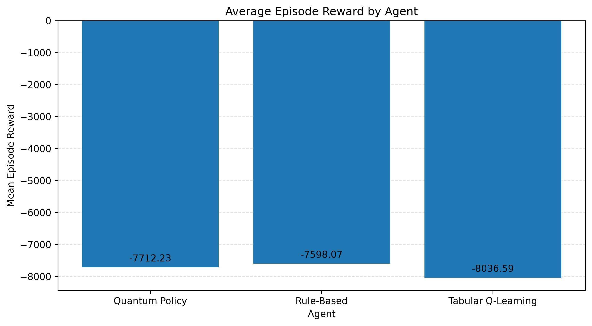
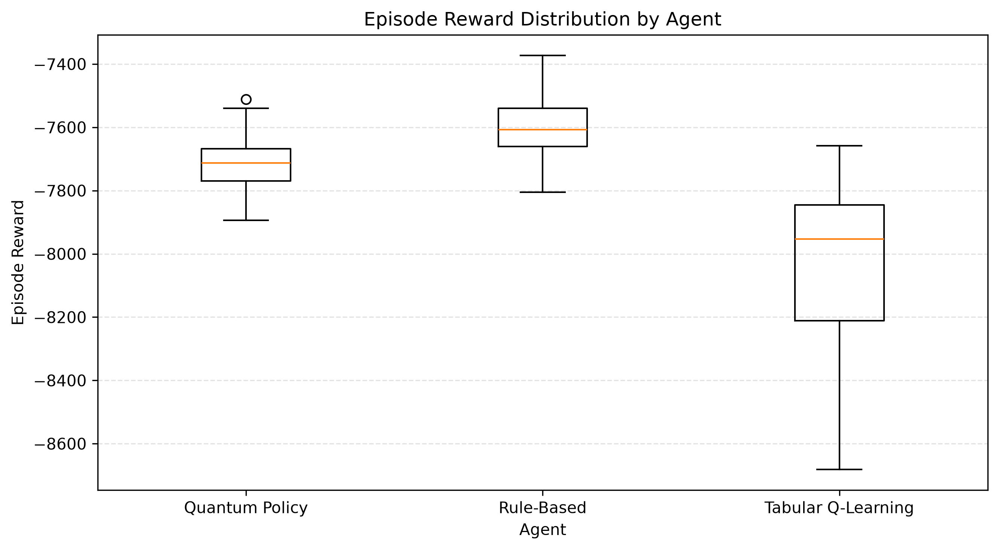
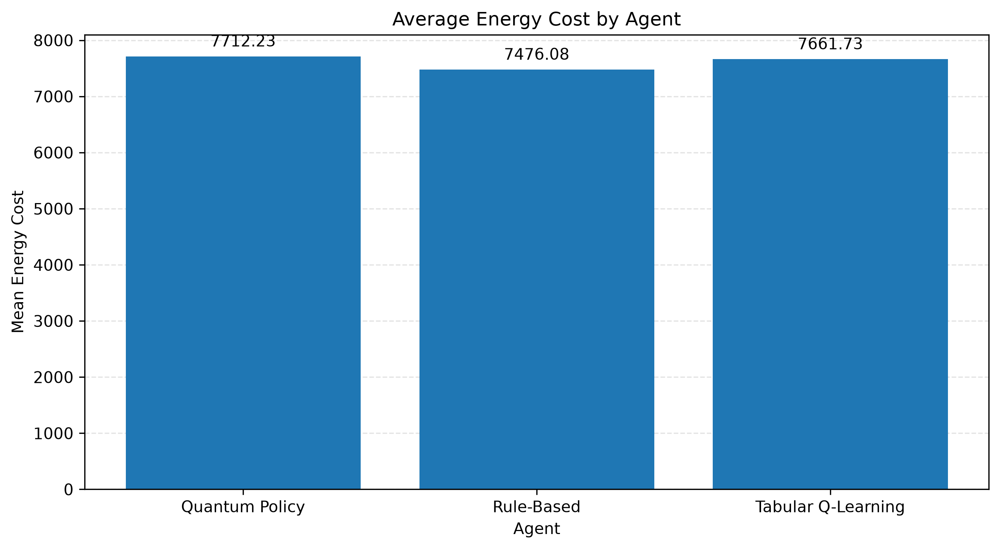
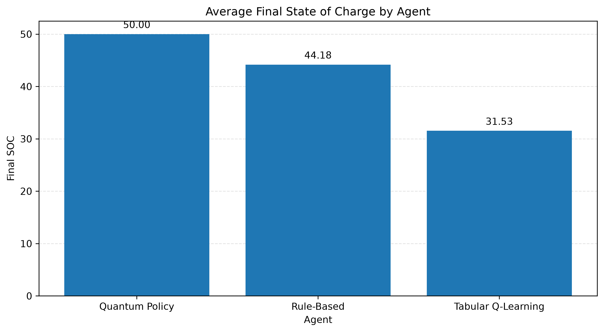
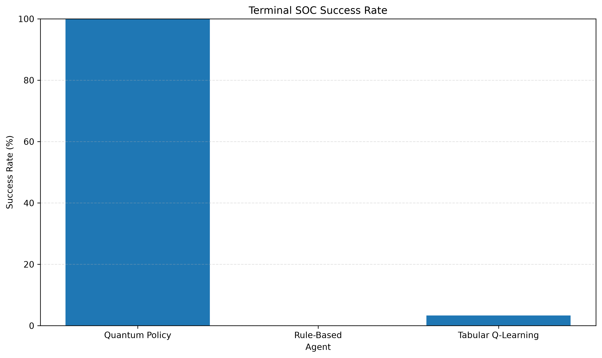
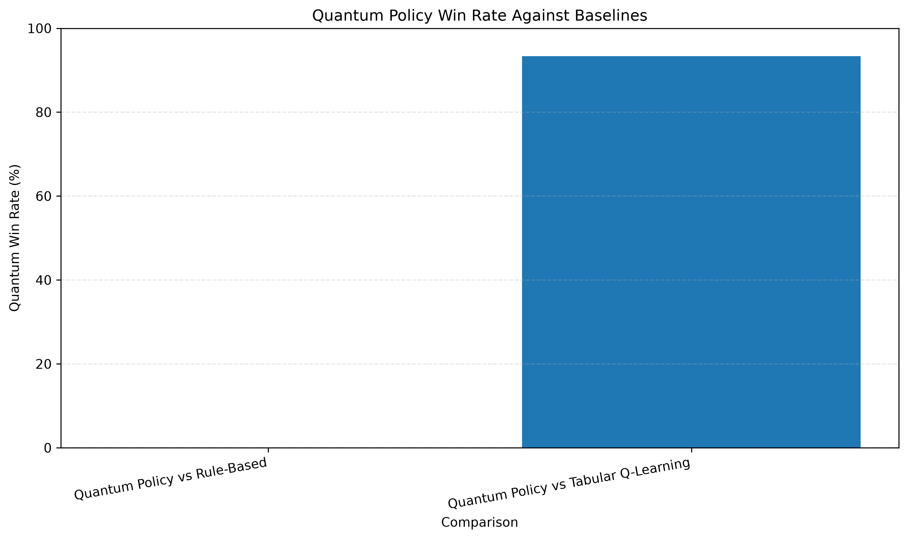

# Hybrid Quantum Battery Reinforcement Learning

## Consolidated Experiment Report

Generated: 2026-11-11T17:24:43+05:30

This report consolidates the experiment outputs currently available in the project's results directory. It does not rerun training or evaluation.

## Experiment Configuration

| Setting | Value |
| --- | --- |
| EXPERIMENT_NAME | hybrid_quantum_battery_rl |
| TRAINING_SEED | 42 |
| EVALUATION_SEED | 1000 |
| TRAINING_ITERATIONS | 80 |
| EPISODES_PER_ESTIMATE | 2 |
| SPSA_LEARNING_RATE | 0.08 |
| SPSA_PERTURBATION | 0.1 |
| VALIDATION_EPISODES | 10 |
| EVALUATION_EPISODES | 30 |

## Output Availability

| Experiment | File | Status |
| --- | --- | --- |
| Quantum Policy Training | quantum_training_history.csv | Available (80 rows) |
| Agent Statistical Evaluation | quantum_agent_comparison_summary.csv | Available (3 rows) |
| Agent Statistical Evaluation | quantum_agent_comparison_details.csv | Available (90 rows) |
| Agent Statistical Evaluation | quantum_agent_pairwise_comparison.csv | Available (2 rows) |
| Quantum Policy Robustness | quantum_robustness_summary.csv | Available (18 rows) |
| Quantum Policy Robustness | quantum_robustness_details.csv | Available (540 rows) |
| Quantum Circuit Ablation | quantum_ablation_summary.csv | Available (3 rows) |
| Classical vs Quantum Benchmark | classical_quantum_benchmark.csv | Available (2 rows) |
| Classical vs Quantum Benchmark | classical_quantum_benchmark_details.csv | Available (60 rows) |

## Quantum Training

- Recorded iterations: 80
- Best recorded validation reward: -7731.778
- Final validation reward: -7731.778
- Mean recorded training reward: -8132.293

### Recent training records

| iteration | reward_plus | reward_minus | gradient_estimate_norm | training_reward | validation_reward | best_validation_reward | is_best_policy | energy_cost | wear_penalty | terminal_penalty | final_soc | terminal_soc_met |
| --- | --- | --- | --- | --- | --- | --- | --- | --- | --- | --- | --- | --- |
| 71 | -7688.85239834932 | -7688.85239834932 | 0.0 | -7786.553022487591 | -7731.777711780759 | -7731.777711780759 | False | 7625.095785645486 | 7.509868421052632 | 153.94736842105274 | 42.30263157894736 | False |
| 72 | -7673.487868219547 | -7673.487868219547 | 0.0 | -8134.447328500732 | -7731.777711780759 | -7731.777711780759 | False | 7445.358512711258 | 8.825657894736842 | 680.2631578947371 | 15.986842105263143 | False |
| 73 | -7746.738194803096 | -7746.738194803096 | 0.0 | -8074.7379853849125 | -7731.777711780759 | -7731.777711780759 | False | 7492.231406437544 | 6.190789473684211 | 576.3157894736843 | 21.184210526315788 | False |
| 74 | -7681.252494747903 | -7681.252494747903 | 0.0 | -7934.373425909828 | -7731.777711780759 | -7731.777711780759 | False | 7299.103689067722 | 6.322368421052632 | 628.9473684210527 | 18.552631578947363 | False |
| 75 | -7679.277069894591 | -7679.277069894591 | 0.0 | -7769.80588018114 | -7731.777711780759 | -7731.777711780759 | False | 7608.3486433390335 | 7.509868421052632 | 153.94736842105303 | 42.30263157894735 | False |
| 76 | -7794.0222124781285 | -7794.0222124781285 | 0.0 | -8316.394475979283 | -7731.777711780759 | -7731.777711780759 | False | 7306.769475979284 | 9.625 | 1000.0 | 0.0 | False |
| 77 | -7764.929229853231 | -7764.929229853231 | 0.0 | -8034.109833510069 | -7731.777711780759 | -7731.777711780759 | False | 7506.478254562699 | 1.3157894736842106 | 526.3157894736843 | 23.684210526315788 | False |
| 78 | -7760.792478508039 | -7760.792478508039 | 0.0 | -8012.8390497253195 | -7731.777711780759 | -7731.777711780759 | False | 7957.9640497253195 | 4.875 | 50.0 | 47.5 | False |
| 79 | -7671.55165122518 | -7671.55165122518 | 0.0 | -7898.5629231845305 | -7731.777711780759 | -7731.777711780759 | False | 7884.220817921372 | 14.342105263157896 | 0.0 | 73.68421052631578 | True |
| 80 | -7706.874204886768 | -7706.874204886768 | 0.0 | -8134.48214066378 | -7731.777711780759 | -7731.777711780759 | False | 7971.968982769044 | 9.881578947368421 | 152.6315789473685 | 42.368421052631575 | False |

## Quantum Policy Training

SPSA training history and validation progress.

### quantum_training_history.csv

Rows: 80 | Columns: 13

| iteration | reward_plus | reward_minus | gradient_estimate_norm | training_reward | validation_reward | best_validation_reward | is_best_policy | energy_cost | wear_penalty | terminal_penalty | final_soc | terminal_soc_met |
| --- | --- | --- | --- | --- | --- | --- | --- | --- | --- | --- | --- | --- |
| 1 | -7764.509675638925 | -7764.509675638925 | 0.0 | -8568.717530875068 | -7731.777711780759 | -7731.777711780759 | False | 7561.467530875068 | 7.25 | 1000.0 | 0.0 | False |
| 2 | -7774.63961574363 | -7774.63961574363 | 0.0 | -8581.848621028583 | -7731.777711780759 | -7731.777711780759 | False | 7571.973621028582 | 9.875 | 1000.0 | 0.0 | False |
| 3 | -7769.009041004752 | -7769.009041004752 | 0.0 | -8435.23262501299 | -7731.777711780759 | -7731.777711780759 | False | 7427.98262501299 | 7.25 | 1000.0 | 0.0 | False |
| 4 | -7765.306306292556 | -7765.306306292556 | 0.0 | -8456.261169180354 | -7731.777711780759 | -7731.777711780759 | False | 7449.011169180355 | 7.25 | 1000.0 | 0.0 | False |
| 5 | -7634.846085577887 | -7634.846085577887 | 0.0 | -7909.993959016291 | -7731.777711780759 | -7731.777711780759 | False | 7850.368959016291 | 9.625 | 50.0 | 47.5 | False |
| 6 | -7639.642235985726 | -7639.642235985726 | 0.0 | -8231.71076107446 | -7731.777711780759 | -7731.777711780759 | False | 7700.648261074461 | 6.0625 | 525.0 | 23.75 | False |
| 7 | -7822.563439702999 | -7822.563439702999 | 0.0 | -8349.438010280035 | -7731.777711780759 | -7731.777711780759 | False | 7766.931431332667 | 6.190789473684211 | 576.3157894736843 | 21.184210526315788 | False |
| 8 | -7651.092856420182 | -7651.092856420182 | 0.0 | -8494.048736197235 | -7731.777711780759 | -7731.777711780759 | False | 7481.542157249866 | 12.506578947368421 | 1000.0 | 0.0 | False |
| 9 | -7806.910690566322 | -7806.910690566322 | 0.0 | -8113.460633762045 | -7731.777711780759 | -7731.777711780759 | False | 8100.69089691994 | 12.769736842105265 | 0.0 | 94.86842105263156 | True |
| 10 | -7758.702350723048 | -7758.702350723048 | 0.0 | -8309.20015435313 | -7731.777711780759 | -7731.777711780759 | False | 8301.436996458393 | 7.763157894736843 | 0.0 | 100.0 | True |
| 11 | -7661.963604722447 | -7661.963604722447 | 0.0 | -8274.05091250596 | -7731.777711780759 | -7731.777711780759 | False | 8263.656175663855 | 10.394736842105264 | 0.0 | 100.0 | True |
| 12 | -7741.659556743181 | -7741.659556743181 | 0.0 | -7762.213319555551 | -7731.777711780759 | -7731.777711780759 | False | 7596.812003766077 | 10.138157894736842 | 155.26315789473728 | 42.236842105263136 | False |
| 13 | -7783.22998078033 | -7783.22998078033 | 0.0 | -7824.707793905938 | -7731.777711780759 | -7731.777711780759 | False | 7770.888714958569 | 2.5032894736842106 | 51.31578947368425 | 47.43421052631579 | False |
| 14 | -7644.896971579638 | -7644.896971579638 | 0.0 | -7770.92994920668 | -7731.777711780759 | -7731.777711780759 | False | 7605.528633417206 | 10.138157894736842 | 155.26315789473742 | 42.23684210526313 | False |
| 15 | -7785.429412555968 | -7785.429412555968 | 0.0 | -8520.460024576369 | -7731.777711780759 | -7731.777711780759 | False | 7512.960024576368 | 7.5 | 1000.0 | 0.0 | False |
| 16 | -7684.894626292042 | -7684.894626292042 | 0.0 | -8049.621694300148 | -7731.777711780759 | -7731.777711780759 | False | 8039.736825879096 | 9.884868421052632 | 0.0 | 89.80263157894734 | True |
| 17 | -7810.596951677408 | -7810.596951677408 | 0.0 | -7944.507424511123 | -7731.777711780759 | -7731.777711780759 | False | 7932.796898195334 | 11.710526315789476 | 0.0 | 73.68421052631578 | True |
| 18 | -7842.501047247208 | -7842.501047247208 | 0.0 | -8312.822329831988 | -7731.777711780759 | -7731.777711780759 | False | 8297.164435095146 | 15.65789473684211 | 0.0 | 100.0 | True |
| 19 | -7695.597686768238 | -7695.597686768238 | 0.0 | -8390.703958028038 | -7731.777711780759 | -7731.777711780759 | False | 7385.828958028038 | 4.875 | 1000.0 | 0.0 | False |
| 20 | -7628.07150458095 | -7628.07150458095 | 0.0 | -8008.320338975545 | -7731.777711780759 | -7731.777711780759 | False | 7426.869681080809 | 3.8190789473684212 | 577.6315789473686 | 21.118421052631575 | False |

_Showing 20 of 80 rows._

## Agent Statistical Evaluation

Reward, cost, terminal SOC and pairwise agent comparisons.

### quantum_agent_comparison_summary.csv

Rows: 3 | Columns: 13

| experiment | agent | episodes | mean_reward | median_reward | std_reward | reward_ci_95_lower | reward_ci_95_upper | mean_energy_cost | mean_wear_penalty | mean_terminal_penalty | mean_final_soc | terminal_soc_success_rate |
| --- | --- | --- | --- | --- | --- | --- | --- | --- | --- | --- | --- | --- |
| hybrid_quantum_battery_rl | Quantum Policy | 30 | -7712.233099012467 | -7712.491930275379 | 94.91270982311399 | -7745.871567212766 | -7678.617608680279 | 7712.233099012467 | 0.0 | 0.0 | 50.0 | 1.0 |
| hybrid_quantum_battery_rl | Rule-Based | 30 | -7598.0688725037635 | -7607.851533716018 | 110.42547148191711 | -7636.195274811431 | -7559.293876498418 | 7476.078960223061 | 5.674122807017542 | 116.31578947368449 | 44.184210526315795 | 0.0 |
| hybrid_quantum_battery_rl | Tabular Q-Learning | 30 | -8035.100646154574 | -7944.7225454330455 | 288.77321102270906 | -8140.894399384672 | -7937.064129151812 | 7638.437159312469 | 18.24243421052632 | 378.421052631579 | 31.616228070175435 | 0.03333333333333333 |

### quantum_agent_comparison_details.csv

Rows: 90 | Columns: 10

| experiment | agent | episode | seed | total_reward | energy_cost | wear_penalty | terminal_penalty | final_soc | terminal_soc_met |
| --- | --- | --- | --- | --- | --- | --- | --- | --- | --- |
| hybrid_quantum_battery_rl | Quantum Policy | 1 | 1000 | -7894.229766126194 | 7894.229766126194 | 0.0 | 0.0 | 50.0 | True |
| hybrid_quantum_battery_rl | Quantum Policy | 2 | 1001 | -7763.954932225929 | 7763.954932225929 | 0.0 | 0.0 | 50.0 | True |
| hybrid_quantum_battery_rl | Quantum Policy | 3 | 1002 | -7580.6620081571145 | 7580.6620081571145 | 0.0 | 0.0 | 50.0 | True |
| hybrid_quantum_battery_rl | Quantum Policy | 4 | 1003 | -7539.3221037232215 | 7539.3221037232215 | 0.0 | 0.0 | 50.0 | True |
| hybrid_quantum_battery_rl | Quantum Policy | 5 | 1004 | -7777.093918142376 | 7777.093918142376 | 0.0 | 0.0 | 50.0 | True |
| hybrid_quantum_battery_rl | Quantum Policy | 6 | 1005 | -7666.695716444894 | 7666.695716444894 | 0.0 | 0.0 | 50.0 | True |
| hybrid_quantum_battery_rl | Quantum Policy | 7 | 1006 | -7718.38605079397 | 7718.38605079397 | 0.0 | 0.0 | 50.0 | True |
| hybrid_quantum_battery_rl | Quantum Policy | 8 | 1007 | -7723.675785040131 | 7723.675785040131 | 0.0 | 0.0 | 50.0 | True |
| hybrid_quantum_battery_rl | Quantum Policy | 9 | 1008 | -7511.440144224999 | 7511.440144224999 | 0.0 | 0.0 | 50.0 | True |
| hybrid_quantum_battery_rl | Quantum Policy | 10 | 1009 | -7712.601520459722 | 7712.601520459722 | 0.0 | 0.0 | 50.0 | True |
| hybrid_quantum_battery_rl | Quantum Policy | 11 | 1010 | -7672.519873731105 | 7672.519873731105 | 0.0 | 0.0 | 50.0 | True |
| hybrid_quantum_battery_rl | Quantum Policy | 12 | 1011 | -7836.158011410037 | 7836.158011410037 | 0.0 | 0.0 | 50.0 | True |
| hybrid_quantum_battery_rl | Quantum Policy | 13 | 1012 | -7640.748095238028 | 7640.748095238028 | 0.0 | 0.0 | 50.0 | True |
| hybrid_quantum_battery_rl | Quantum Policy | 14 | 1013 | -7693.209169485586 | 7693.209169485586 | 0.0 | 0.0 | 50.0 | True |
| hybrid_quantum_battery_rl | Quantum Policy | 15 | 1014 | -7742.097813890853 | 7742.097813890853 | 0.0 | 0.0 | 50.0 | True |
| hybrid_quantum_battery_rl | Quantum Policy | 16 | 1015 | -7828.961461739307 | 7828.961461739307 | 0.0 | 0.0 | 50.0 | True |
| hybrid_quantum_battery_rl | Quantum Policy | 17 | 1016 | -7892.909066878357 | 7892.909066878357 | 0.0 | 0.0 | 50.0 | True |
| hybrid_quantum_battery_rl | Quantum Policy | 18 | 1017 | -7712.382340091035 | 7712.382340091035 | 0.0 | 0.0 | 50.0 | True |
| hybrid_quantum_battery_rl | Quantum Policy | 19 | 1018 | -7586.171828673215 | 7586.171828673215 | 0.0 | 0.0 | 50.0 | True |
| hybrid_quantum_battery_rl | Quantum Policy | 20 | 1019 | -7842.976023446615 | 7842.976023446615 | 0.0 | 0.0 | 50.0 | True |

_Showing 20 of 90 rows._

### quantum_agent_pairwise_comparison.csv

Rows: 2 | Columns: 11

| experiment | comparison | scenarios_compared | quantum_wins | ties | quantum_losses | quantum_win_rate | tie_rate | quantum_loss_rate | mean_reward_difference | median_reward_difference |
| --- | --- | --- | --- | --- | --- | --- | --- | --- | --- | --- |
| hybrid_quantum_battery_rl | Quantum Policy vs Rule-Based | 30 | 0 | 0 | 30 | 0.0 | 0.0 | 1.0 | -114.16422650870396 | -105.41664733236576 |
| hybrid_quantum_battery_rl | Quantum Policy vs Tabular Q-Learning | 30 | 28 | 0 | 2 | 0.9333333333333333 | 0.0 | 0.06666666666666667 | 322.8675471421057 | 312.5308812440121 |

## Quantum Policy Robustness

Policy performance under changed battery and market conditions.

### quantum_robustness_summary.csv

Rows: 18 | Columns: 13

| scenario | agent | episodes | mean_reward | std_reward | mean_energy_cost | mean_wear_penalty | mean_terminal_penalty | mean_final_soc | terminal_soc_success_rate | normal_mean_reward | reward_change | reward_change_percent |
| --- | --- | --- | --- | --- | --- | --- | --- | --- | --- | --- | --- | --- |
| high_demand_volatility | Quantum Policy | 30 | -7748.544042960567 | 323.5206024347309 | 7748.544042960567 | 0.0 | 0.0 | 50.0 | 1.0 | -7735.454668810993 | -13.089374149573814 | -0.16921273163618403 |
| high_demand_volatility | Rule-Based | 30 | -7642.029994760893 | 328.500165451867 | 7523.628021076684 | 5.507236842105263 | 112.89473684210552 | 44.35526315789472 | 0.0 | -7631.8941504970435 | -10.135844263849322 | -0.132809025701558 |
| high_demand_volatility | Tabular Q-Learning | 30 | -8107.9114520260855 | 355.86581206827 | 7750.571210798013 | 17.603399122807016 | 339.73684210526324 | 36.91008771929823 | 0.16666666666666666 | -8116.696876514643 | 8.78542448855751 | 0.10823891322069455 |
| high_initial_soc | Quantum Policy | 30 | -8078.52899968925 | 111.95398538941389 | 7550.897420741881 | 1.3157894736842104 | 526.3157894736843 | 53.68421052631579 | 0.0 | -7735.454668810993 | -343.07433087825666 | -4.435089410600737 |
| high_initial_soc | Rule-Based | 30 | -8118.790676665734 | 212.7248519775168 | 7232.2677599990675 | 4.461513157894737 | 882.0614035087722 | 35.8969298245614 | 0.0 | -7631.8941504970435 | -486.8965261686908 | -6.379759946447641 |
| high_initial_soc | Tabular Q-Learning | 30 | -8373.72667981807 | 315.19058754096943 | 7426.747293853158 | 17.76885964912281 | 929.2105263157896 | 33.53947368421052 | 0.0 | -8116.696876514643 | -257.0298033034269 | -3.166679835576131 |
| high_price_volatility | Quantum Policy | 30 | -7800.5694185918155 | 332.3690729294861 | 7800.5694185918155 | 0.0 | 0.0 | 50.0 | 1.0 | -7735.454668810993 | -65.11474978082242 | -0.8417701682534858 |
| high_price_volatility | Rule-Based | 30 | -7550.373954267886 | 329.3624046236297 | 7409.835577074903 | 8.827850877192983 | 131.71052631578982 | 47.60964912280699 | 0.23333333333333334 | -7631.8941504970435 | 81.52019622915759 | 1.0681515574197058 |
| high_price_volatility | Tabular Q-Learning | 30 | -8157.401545823891 | 390.7456308774478 | 7799.4448572274 | 17.95668859649123 | 340.00000000000006 | 40.75219298245613 | 0.3333333333333333 | -8116.696876514643 | -40.70466930924795 | -0.501493032553986 |
| low_initial_soc | Quantum Policy | 30 | -7716.397523401018 | 108.25898282649796 | 7716.397523401018 | 0.0 | 0.0 | 20.0 | 1.0 | -7735.454668810993 | 19.05714540997542 | 0.24636102499330745 |
| low_initial_soc | Rule-Based | 30 | -7644.603863733102 | 116.94371624908527 | 7638.242898820821 | 6.360964912280703 | 0.0 | 38.44736842105262 | 1.0 | -7631.8941504970435 | -12.709713236058633 | -0.16653419171479056 |
| low_initial_soc | Tabular Q-Learning | 30 | -8033.676737132997 | 185.31510588039566 | 7871.183535378612 | 15.826535087719298 | 146.66666666666666 | 28.39035087719298 | 0.6333333333333333 | -8116.696876514643 | 83.020139381646 | 1.0228315858617518 |
| normal | Quantum Policy | 30 | -7735.454668810993 | 101.9054139586053 | 7735.454668810993 | 0.0 | 0.0 | 50.0 | 1.0 | -7735.454668810993 | 0.0 | 0.0 |
| normal | Rule-Based | 30 | -7631.8941504970435 | 105.38766617564231 | 7514.996233830377 | 5.713706140350878 | 111.18421052631604 | 44.975877192982445 | 0.03333333333333333 | -7631.8941504970435 | 0.0 | 0.0 |
| normal | Tabular Q-Learning | 30 | -8116.696876514643 | 271.0085710069708 | 7827.951481777801 | 19.14013157894737 | 269.60526315789485 | 39.28508771929823 | 0.13333333333333333 | -8116.696876514643 | 0.0 | 0.0 |
| unseen_scenarios | Quantum Policy | 30 | -7754.861585724315 | 131.77332360361743 | 7754.861585724315 | 0.0 | 0.0 | 50.0 | 1.0 | -7735.454668810993 | -19.406916913321766 | -0.25088269202286956 |
| unseen_scenarios | Rule-Based | 30 | -7657.293452063234 | 126.73593825464023 | 7542.479416975515 | 5.340350877192983 | 109.47368421052656 | 44.52631578947367 | 0.0 | -7631.8941504970435 | -25.399301566190843 | -0.33280468865696544 |
| unseen_scenarios | Tabular Q-Learning | 30 | -8088.130993849088 | 299.5403718347203 | 7710.228581568385 | 18.823464912280702 | 359.0789473684211 | 35.77631578947368 | 0.16666666666666666 | -8116.696876514643 | 28.565882665555364 | 0.351939749631524 |

### quantum_robustness_details.csv

Rows: 540 | Columns: 14

| experiment | scenario | agent | episode | seed | initial_soc | price_noise_std | demand_noise_std | total_reward | energy_cost | wear_penalty | terminal_penalty | final_soc | terminal_soc_met |
| --- | --- | --- | --- | --- | --- | --- | --- | --- | --- | --- | --- | --- | --- |
| hybrid_quantum_battery_rl | normal | Quantum Policy | 1 | 11000 | 0.5 | 0.4 | 2.0 | -7756.23869039503 | 7756.23869039503 | 0.0 | 0.0 | 50.0 | True |
| hybrid_quantum_battery_rl | normal | Quantum Policy | 2 | 11001 | 0.5 | 0.4 | 2.0 | -7681.579818625221 | 7681.579818625221 | 0.0 | 0.0 | 50.0 | True |
| hybrid_quantum_battery_rl | normal | Quantum Policy | 3 | 11002 | 0.5 | 0.4 | 2.0 | -7740.798957692679 | 7740.798957692679 | 0.0 | 0.0 | 50.0 | True |
| hybrid_quantum_battery_rl | normal | Quantum Policy | 4 | 11003 | 0.5 | 0.4 | 2.0 | -7504.898309713338 | 7504.898309713338 | 0.0 | 0.0 | 50.0 | True |
| hybrid_quantum_battery_rl | normal | Quantum Policy | 5 | 11004 | 0.5 | 0.4 | 2.0 | -7924.569577223322 | 7924.569577223322 | 0.0 | 0.0 | 50.0 | True |
| hybrid_quantum_battery_rl | normal | Quantum Policy | 6 | 11005 | 0.5 | 0.4 | 2.0 | -7622.386350147401 | 7622.386350147401 | 0.0 | 0.0 | 50.0 | True |
| hybrid_quantum_battery_rl | normal | Quantum Policy | 7 | 11006 | 0.5 | 0.4 | 2.0 | -7707.152923121096 | 7707.152923121096 | 0.0 | 0.0 | 50.0 | True |
| hybrid_quantum_battery_rl | normal | Quantum Policy | 8 | 11007 | 0.5 | 0.4 | 2.0 | -7617.125743537079 | 7617.125743537079 | 0.0 | 0.0 | 50.0 | True |
| hybrid_quantum_battery_rl | normal | Quantum Policy | 9 | 11008 | 0.5 | 0.4 | 2.0 | -7523.341932783742 | 7523.341932783742 | 0.0 | 0.0 | 50.0 | True |
| hybrid_quantum_battery_rl | normal | Quantum Policy | 10 | 11009 | 0.5 | 0.4 | 2.0 | -7771.881986305522 | 7771.881986305522 | 0.0 | 0.0 | 50.0 | True |
| hybrid_quantum_battery_rl | normal | Quantum Policy | 11 | 11010 | 0.5 | 0.4 | 2.0 | -7710.850441159502 | 7710.850441159502 | 0.0 | 0.0 | 50.0 | True |
| hybrid_quantum_battery_rl | normal | Quantum Policy | 12 | 11011 | 0.5 | 0.4 | 2.0 | -7802.585560242983 | 7802.585560242983 | 0.0 | 0.0 | 50.0 | True |
| hybrid_quantum_battery_rl | normal | Quantum Policy | 13 | 11012 | 0.5 | 0.4 | 2.0 | -7793.208300337477 | 7793.208300337477 | 0.0 | 0.0 | 50.0 | True |
| hybrid_quantum_battery_rl | normal | Quantum Policy | 14 | 11013 | 0.5 | 0.4 | 2.0 | -7802.020397674922 | 7802.020397674922 | 0.0 | 0.0 | 50.0 | True |
| hybrid_quantum_battery_rl | normal | Quantum Policy | 15 | 11014 | 0.5 | 0.4 | 2.0 | -7641.974444911778 | 7641.974444911778 | 0.0 | 0.0 | 50.0 | True |
| hybrid_quantum_battery_rl | normal | Quantum Policy | 16 | 11015 | 0.5 | 0.4 | 2.0 | -7767.09204767847 | 7767.09204767847 | 0.0 | 0.0 | 50.0 | True |
| hybrid_quantum_battery_rl | normal | Quantum Policy | 17 | 11016 | 0.5 | 0.4 | 2.0 | -7584.040912024057 | 7584.040912024057 | 0.0 | 0.0 | 50.0 | True |
| hybrid_quantum_battery_rl | normal | Quantum Policy | 18 | 11017 | 0.5 | 0.4 | 2.0 | -7817.652576479561 | 7817.652576479561 | 0.0 | 0.0 | 50.0 | True |
| hybrid_quantum_battery_rl | normal | Quantum Policy | 19 | 11018 | 0.5 | 0.4 | 2.0 | -7838.76795870166 | 7838.76795870166 | 0.0 | 0.0 | 50.0 | True |
| hybrid_quantum_battery_rl | normal | Quantum Policy | 20 | 11019 | 0.5 | 0.4 | 2.0 | -7684.3680393605855 | 7684.3680393605855 | 0.0 | 0.0 | 50.0 | True |

_Showing 20 of 540 rows._

## Quantum Circuit Ablation

Comparison of quantum circuit depths.

### quantum_ablation_summary.csv

Rows: 3 | Columns: 10

| architecture | n_qubits | n_layers | trainable_parameters | training_iterations | mean_validation_reward | std_validation_reward | best_validation_reward | training_time_seconds | evaluation_time_seconds |
| --- | --- | --- | --- | --- | --- | --- | --- | --- | --- |
| shallow_1_layer | 4 | 1 | 12 | 40 | -7731.777711780759 | 138.94167140823743 | -7731.777711780759 | 28.103120700000005 | 0.4596172999999908 |
| baseline_2_layers | 4 | 2 | 24 | 40 | -7731.777711780759 | 138.94167140823743 | -7731.777711780759 | 41.565062400000016 | 0.7132317000000512 |
| deep_3_layers | 4 | 3 | 36 | 40 | -7731.777711780759 | 138.94167140823743 | -7731.777711780759 | 55.83386039999999 | 0.9601652000000058 |

## Classical vs Quantum Benchmark

Comparison of a classical neural policy and quantum policy.

### classical_quantum_benchmark.csv

Rows: 2 | Columns: 12

| agent | trainable_parameters | training_iterations | best_validation_reward | mean_evaluation_reward | std_evaluation_reward | mean_energy_cost | mean_final_soc | terminal_soc_success_rate | training_time_seconds | evaluation_time_seconds | mean_inference_time_ms |
| --- | --- | --- | --- | --- | --- | --- | --- | --- | --- | --- | --- |
| Quantum Policy | 24 | 80 | -7731.777711780759 | -7712.233099012467 | 93.31742461316865 | 7712.233099012467 | 50.0 | 1.0 | 95.74381300000005 | 2.173056900000006 | 3.18149194444304 |
| Classical Neural Policy | 67 | 80 | -7731.777711780759 | -7712.233099012467 | 93.31742461316865 | 7712.233099012467 | 50.0 | 1.0 | 1.3811885999999731 | 0.036637400000017806 | 0.03025319444544847 |

### Benchmark observations

- All benchmarked agents have identical mean evaluation rewards. This should be investigated before drawing performance conclusions.
- Fastest training in this run: Classical Neural Policy (1.381 seconds).
- Lowest measured inference time: Classical Neural Policy (0.0303 ms).

_These observations describe the recorded experiment only. They do not establish general quantum advantage._

### classical_quantum_benchmark_details.csv

Rows: 60 | Columns: 9

| agent | episode | seed | reward | energy_cost | wear_penalty | terminal_penalty | final_soc | terminal_soc_met |
| --- | --- | --- | --- | --- | --- | --- | --- | --- |
| Quantum Policy | 1 | 1000 | -7894.229766126194 | 7894.229766126194 | 0.0 | 0.0 | 50.0 | True |
| Quantum Policy | 2 | 1001 | -7763.954932225929 | 7763.954932225929 | 0.0 | 0.0 | 50.0 | True |
| Quantum Policy | 3 | 1002 | -7580.6620081571145 | 7580.6620081571145 | 0.0 | 0.0 | 50.0 | True |
| Quantum Policy | 4 | 1003 | -7539.3221037232215 | 7539.3221037232215 | 0.0 | 0.0 | 50.0 | True |
| Quantum Policy | 5 | 1004 | -7777.093918142376 | 7777.093918142376 | 0.0 | 0.0 | 50.0 | True |
| Quantum Policy | 6 | 1005 | -7666.695716444894 | 7666.695716444894 | 0.0 | 0.0 | 50.0 | True |
| Quantum Policy | 7 | 1006 | -7718.38605079397 | 7718.38605079397 | 0.0 | 0.0 | 50.0 | True |
| Quantum Policy | 8 | 1007 | -7723.675785040131 | 7723.675785040131 | 0.0 | 0.0 | 50.0 | True |
| Quantum Policy | 9 | 1008 | -7511.440144224999 | 7511.440144224999 | 0.0 | 0.0 | 50.0 | True |
| Quantum Policy | 10 | 1009 | -7712.601520459722 | 7712.601520459722 | 0.0 | 0.0 | 50.0 | True |
| Quantum Policy | 11 | 1010 | -7672.519873731105 | 7672.519873731105 | 0.0 | 0.0 | 50.0 | True |
| Quantum Policy | 12 | 1011 | -7836.158011410037 | 7836.158011410037 | 0.0 | 0.0 | 50.0 | True |
| Quantum Policy | 13 | 1012 | -7640.748095238028 | 7640.748095238028 | 0.0 | 0.0 | 50.0 | True |
| Quantum Policy | 14 | 1013 | -7693.209169485586 | 7693.209169485586 | 0.0 | 0.0 | 50.0 | True |
| Quantum Policy | 15 | 1014 | -7742.097813890853 | 7742.097813890853 | 0.0 | 0.0 | 50.0 | True |
| Quantum Policy | 16 | 1015 | -7828.961461739307 | 7828.961461739307 | 0.0 | 0.0 | 50.0 | True |
| Quantum Policy | 17 | 1016 | -7892.909066878357 | 7892.909066878357 | 0.0 | 0.0 | 50.0 | True |
| Quantum Policy | 18 | 1017 | -7712.382340091035 | 7712.382340091035 | 0.0 | 0.0 | 50.0 | True |
| Quantum Policy | 19 | 1018 | -7586.171828673215 | 7586.171828673215 | 0.0 | 0.0 | 50.0 | True |
| Quantum Policy | 20 | 1019 | -7842.976023446615 | 7842.976023446615 | 0.0 | 0.0 | 50.0 | True |

_Showing 20 of 60 rows._

## Available Figures

### agent_mean_reward.png

### agent_reward_distribution.png

### agent_energy_cost.png

### agent_final_soc.png

### agent_terminal_soc_success.png

### quantum_policy_win_rate.png

## Limitations and Interpretation

- Results depend on the environment, seeds, training budget and policy implementation used in each experiment.
- Missing CSV files indicate that an experiment output was not available when this report was generated.
- Identical results across policies should be investigated; they should not automatically be interpreted as equivalent learning performance.
- Simulation results alone do not establish real-world battery performance or quantum advantage.

## Reproducibility

The configuration table above records the settings available in `config/experiment_config.py`. Individual experiment scripts may also define experiment-specific settings.
